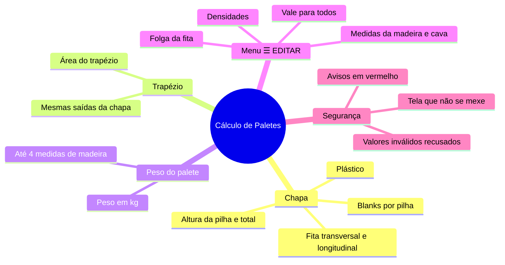
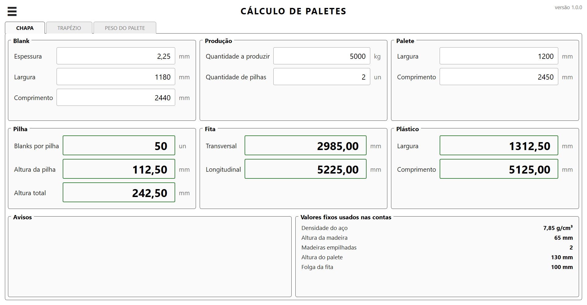
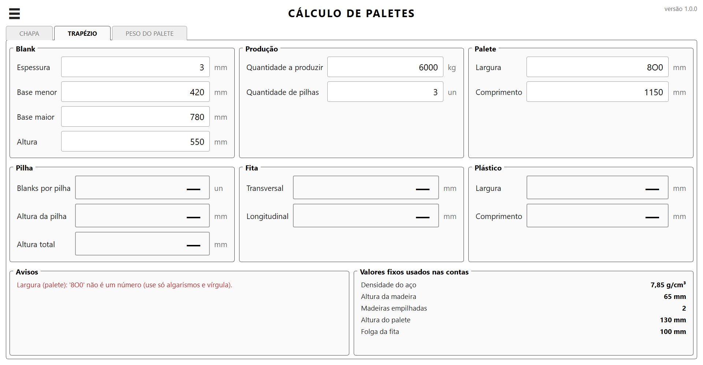
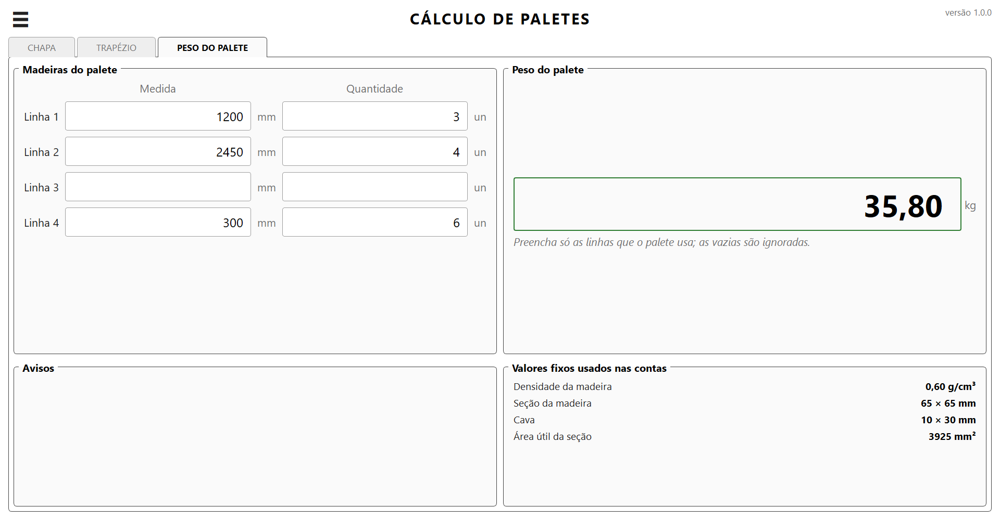
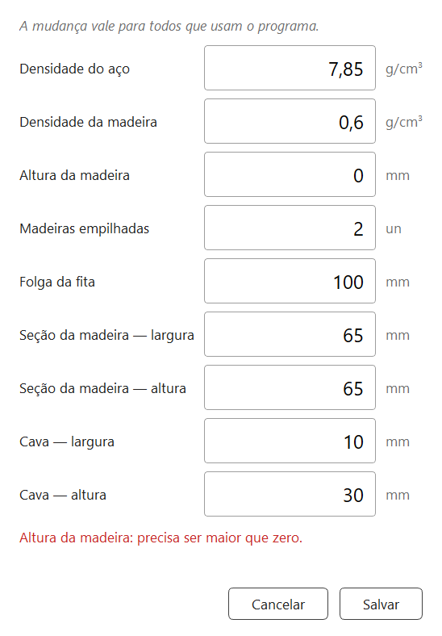
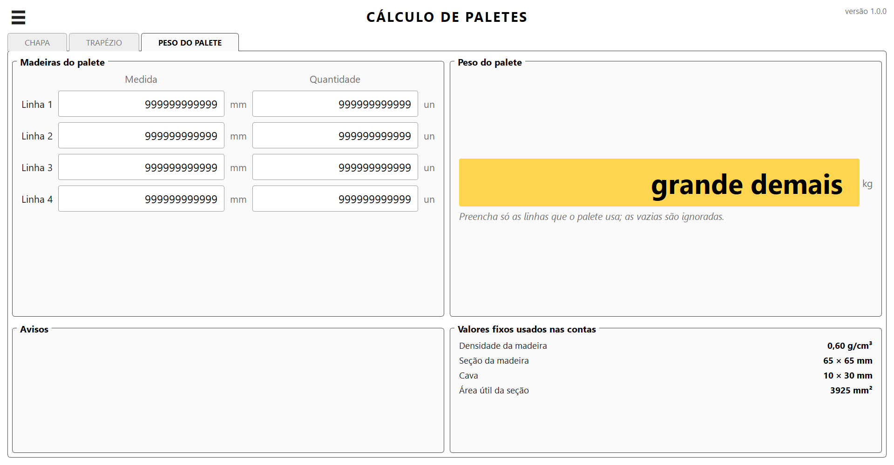
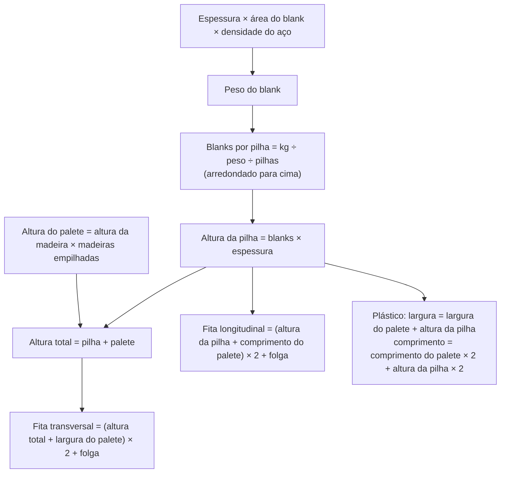
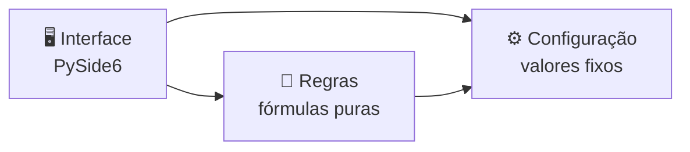
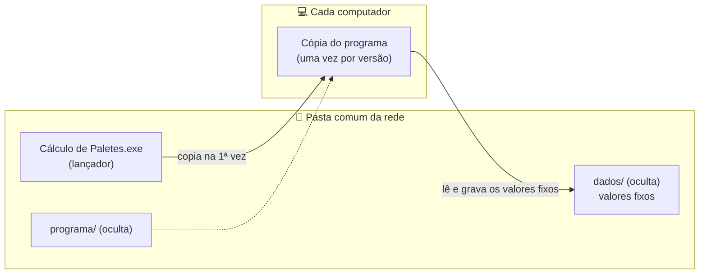
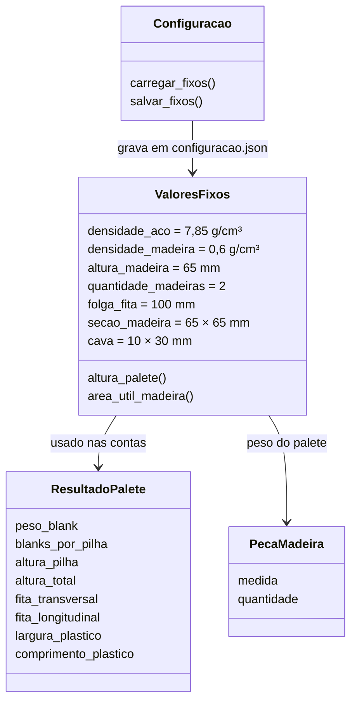

<div align="center">

# 📦 Cálculo de Paletes


**Calculadora desktop para a engenharia definir o palete de chapas e trapézios de aço:**
**blanks por pilha, alturas, fita de arquear, plástico e peso do palete de madeira — na hora, sem planilha.**

[🎯 Visão Geral](#-visão-geral) •
[📊 Em números](#-em-números) •
[📸 Telas](#-telas) •
[✨ Funcionalidades](#-funcionalidades) •
[🧮 Como as contas funcionam](#-como-as-contas-funcionam) •
[🏗️ Arquitetura](#️-arquitetura) •
[🗂️ Modelo de dados](#️-modelo-de-dados) •
[🛠️ Como foi desenvolvido](#️-como-foi-desenvolvido)

</div>

---

## 🎯 Visão Geral

| ❌ Problema | 💡 Solução | ✅ Resultado |
|---|---|---|
| Os cálculos ficavam numa planilha com campos de entrada e de resultado espalhados, fórmulas misturadas e células de teste | Um programa com uma tela por tipo de cálculo, só com os campos que importam | Quem usa digita as medidas e vê os resultados na hora, sem risco de apagar uma fórmula |
| Valores de referência (densidades, altura da madeira, folga da fita) escondidos dentro das fórmulas | Valores fixos sempre visíveis na tela e editáveis num menu próprio | Todo mundo sabe com quais valores a conta foi feita |
| A planilha dava "163,2 blanks por pilha" e tinha duas versões da mesma conta de fita | Regras levantadas célula por célula com o usuário; blanks arredondados para cima | Um resultado só, que dá para montar de verdade |
| Erro de digitação (uma letra no lugar de um zero) passava despercebido | Avisos em vermelho dizendo qual campo está errado | Nenhum resultado aparece com dado errado |



### 🎯 Objetivos
- Substituir a planilha por uma tela simples, sem fórmula para apagar sem querer.
- Mostrar **só** o que a engenharia usa: as entradas e os resultados que importam.
- Deixar os valores de referência à vista e fáceis de mudar, valendo para todos.
- Nunca mostrar um resultado com dado errado.

---

## 📊 Em números

| | |
|---|---|
| 🧪 **Testes automáticos** | 68 no GitHub (fórmulas, janela, EDITAR, configuração e lançador) + 3 locais conferindo com a planilha original |
| 📝 **Linhas de código** | ~1.500 no programa e ~600 nos testes |
| 🔀 **Pull Requests** | 6, um por fase + uma correção |
| 🗺️ **Fases** | 6 (0 a 5) |
| 🏷️ **Versões** | 0.1.0 → 0.2.0 → 0.3.0 → 1.0.0 (em uso) → 1.0.1 |
| 📐 **Decisões registradas (ADRs)** | 4 |
| ⚡ **Recálculo a cada tecla** | menos de 1 ms (0,77 ms medido) |
| 🪟 **Janela montada** | ~70 ms |

---

## 📸 Telas

> Todas as fotos usam **números fictícios**, e o programa aparece sem o logo da empresa.

<div align="center">



*Aba **CHAPA**: medidas digitadas, resultados com borda verde e os valores fixos usados nas contas.*

</div>

| | |
|:---:|:---:|
|  |  |
| *Letra "O" no lugar do zero: aviso em vermelho dizendo o campo* | *Peso do palete: só as linhas preenchidas entram na conta* |
|  |  |
| *EDITAR: valor inválido é recusado e nada é salvo* | *Número enorme: a tela não se mexe, aparece "grande demais"* |

---

## ✨ Funcionalidades

- 🟦 **Chapa** — a partir da espessura, largura, comprimento, quantidade a produzir, número de pilhas e
  medidas do palete, calcula blanks por pilha (arredondado para cima), alturas, fitas e plástico.
- 🔷 **Trapézio** — o mesmo cálculo para blanks trapezoidais (base menor, base maior e altura).
- 🪵 **Peso do palete** — até 4 medidas de madeira com suas quantidades e o peso total do palete.
- ⚙️ **Valores fixos editáveis** — densidade do aço e da madeira, altura e seção da madeira, cava e
  folga da fita, sempre visíveis e alteráveis pelo menu ☰ → EDITAR (Salvar / Cancelar), valendo
  para todos que usam o programa.
- ⌨️ **Contas na hora** — sem botão de calcular: os resultados se refazem a cada tecla; Enter pula
  para o próximo campo.
- 🚨 **Avisos claros** — erro de digitação, valor zerado ou base menor maior que a base maior aparecem
  em vermelho, dizendo o campo; os resultados ficam em "—" até tudo estar certo.
- 🧱 **Tela que não se mexe** — campos com no máximo 12 caracteres e resultados com largura fixa; um
  número enorme vira "grande demais" em amarelo, com o valor inteiro na dica do mouse.

<details>
<summary><b>🎨 Cores com significado</b></summary>

| Cor | Significa |
|---|---|
| 🟢 Verde | Resultado calculado (borda da caixa) |
| 🔴 Vermelho | Erro: o aviso diz qual campo corrigir |
| 🟡 Amarelo | Aviso: número grande demais para a caixa |
| ⚪ Cinza itálico | Dica (ex.: "Preencha todos os campos para ver o resultado") |

Tema **claro** neste programa (os outros programas da série usam o tema escuro); o significado das
cores é o mesmo em todos.
</details>

---

## 🧮 Como as contas funcionam



- **Área do blank:** chapa = largura × comprimento; trapézio = (base menor + base maior) ÷ 2 × altura.
- **Peso do palete:** soma de (seção da madeira − cava) × medida × quantidade × densidade da madeira.
- As fórmulas seguem as células que a engenharia já usava na planilha; a única mudança de propósito é
  o **arredondamento dos blanks para cima** (não existe meio blank), e a altura da pilha usa esse
  número arredondado.

---

## 🏗️ Arquitetura



As fórmulas não conhecem a tela: são funções puras, testadas sozinhas com pytest. A janela só lê os
campos, chama as regras e mostra os resultados. A configuração é a única parte que grava arquivo.

### 🌐 Distribuição na rede



Sem servidor: o lançador copia o programa para o PC uma vez por versão e abre a cópia em 1–2 s; os
valores fixos ficam só na rede, iguais para todos. Atualizar = trocar a pasta `programa`.

| Tecnologia | Aplicação no projeto |
|---|---|
| 🐍 Python 3.12+ | Linguagem do programa e das regras de cálculo |
| 🖼️ PySide6 (Qt) | Interface desktop em tema claro, sempre maximizada, com as contas refeitas a cada tecla |
| 🧪 pytest | Testes automáticos das fórmulas e da janela (modo offscreen) |
| 🧹 Ruff | Verificação de estilo e de erros comuns |
| 📦 PyInstaller | Empacotamento em `.exe` com lançador para a pasta da rede |
| 🗃️ JSON | Valores fixos editados, gravados de forma segura na rede |
| 🤖 Claude Code | Desenvolvimento assistido por IA, passo a passo |

---

## 🗂️ Modelo de dados



Não há banco de dados: o programa é só calculadora. A única coisa gravada são os valores fixos, num
arquivo `configuracao.json` na pasta de dados da rede.

---

## 🛠️ Como foi desenvolvido

- Uma fase por vez, cada uma numa branch com Pull Request e commits pequenos em português.
- Regras de negócio levantadas com o usuário a partir da planilha original, conferindo célula por célula.
- Testes automáticos das fórmulas antes de qualquer tela; os pesos conferidos com os números da
  planilha (testes só locais) e os testes publicados usam números fictícios.
- Cada mudança de visual mostrada primeiro numa foto de prévia, sem mexer no programa.
- Decisões de arquitetura registradas em ADRs (`docs/decisoes/`).

### 🗺️ Roteiro

- [x] **Fase 0** — Levantamento das regras e estrutura do projeto
- [x] **Fase 1** — Regras de cálculo (chapa, trapézio, peso do palete) com testes
- [x] **Fase 2** — Janela com as três abas: contas na hora, avisos em vermelho e tela que não se mexe com números enormes
- [x] **Fase 3** — Menu ☰ → EDITAR: valores fixos editáveis, gravados para todos e com as contas refeitas na hora
- [x] **Fase 4** — Programa empacotado com lançador (cópia local rápida) e em uso na rede (versão 1.0.0)
- [x] **Fase 5** — Portfólio: fotos das telas (dados fictícios) e README completo

<details>
<summary><b>📜 História das fases</b></summary>

| Fase | Versão | O que entrou |
|---|---|---|
| 0 | — | Leitura da planilha, regras combinadas com o usuário, estrutura do projeto e dados da empresa fora do Git |
| 1 | 0.1.0 | Fórmulas de chapa, trapézio e peso do palete, com valores fixos num lugar só e erros em português |
| 2 | 0.2.0 | Janela com três abas, tema claro, fonte grande, avisos e proteção contra números enormes |
| 3 | 0.3.0 | Menu ☰ e EDITAR com Salvar/Cancelar, gravando os valores fixos na rede (a senha foi testada e retirada) |
| 4 | 1.0.0 | Lançador e `.exe`; primeira versão em uso na empresa |
| 5 | 1.0.1 | Fotos e README de portfólio; correção do "grande demais" quando a conta era refeita com a aba escondida |

</details>

<details>
<summary><b>📄 Antes: a planilha</b></summary>

Antes do programa, as contas ficavam numa planilha do Excel com várias abas:

- **Chapa e trapézio** — campos de entrada e de resultado espalhados pela mesma aba, com mais de uma
  versão da mesma conta (ex.: duas fórmulas de fita) e células de teste.
- **Custo do palete de madeira** — peças, peso, metro linear e custo, repetido em vários blocos.
- **Outras contas avulsas** — bobina, produtividade da linha e uma análise pontual.

O programa ficou só com o que a engenharia usa para definir o palete (chapa, trapézio e peso do
palete); o resto continua fora, até ser pedido. A planilha não faz parte deste repositório.
</details>

### 📁 Estrutura do repositório

```
CalculoPaletes/
├── src/calculo_paletes/
│   ├── regras/            # fórmulas puras e valores fixos (sem Qt)
│   ├── armazenamento/     # configuracao.json dos valores fixos
│   ├── interface/         # janela, abas, menu ☰, EDITAR e estilo
│   ├── lancador.py        # .exe da rede: copia o programa para o PC
│   └── __main__.py
├── tests/                 # 68 testes (números fictícios)
├── docs/
│   ├── decisoes/          # ADRs 0001–0004
│   └── telas/             # fotos do README
├── CLAUDE.md              # regras do projeto
└── pyproject.toml
```

Fora do Git (ficam só no PC): a planilha original, os testes com números reais, o logo e os scripts
de gerar o `.exe`.

---

## 🧠 Competências

`Python` · `PySide6` · `Testes automatizados` · `Arquitetura em camadas` · `Levantamento de requisitos` ·
`Git/GitHub com PRs` · `Empacotamento e distribuição` · `Desenvolvimento assistido por IA`

---

<div align="center">

**Da planilha bagunçada para uma calculadora clara, testada e fácil de manter.**

</div>
