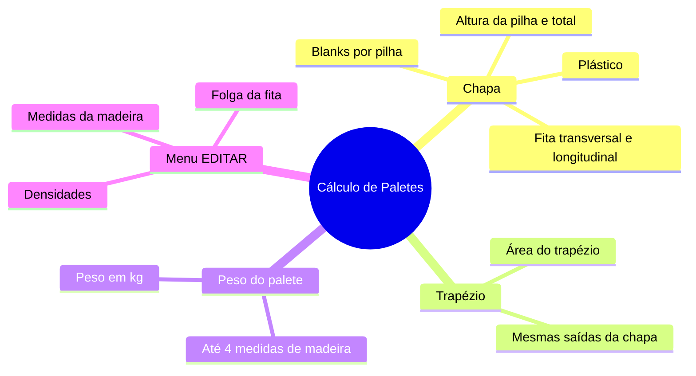
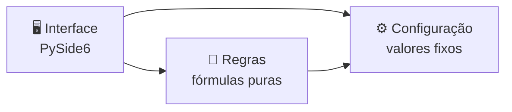

# 📦 Cálculo de Paletes

**Calculadora desktop para a engenharia definir o palete de chapas e trapézios de aço:**
**blanks por pilha, alturas, fita de arquear, plástico e peso do palete de madeira — na hora, sem planilha.**

---

## 🎯 Visão Geral

| ❌ Problema | 💡 Solução | ✅ Resultado |
|---|---|---|
| Os cálculos ficavam numa planilha com campos de entrada e de resultado espalhados, fórmulas misturadas e células de teste | Um programa com uma tela por tipo de cálculo, só com os campos que importam | Quem usa digita as medidas e vê os resultados na hora, sem risco de apagar uma fórmula |
| Valores de referência (densidades, altura da madeira, folga da fita) escondidos dentro das fórmulas | Valores fixos sempre visíveis na tela e editáveis num menu próprio | Todo mundo sabe com quais valores a conta foi feita |

## ✨ Funcionalidades

- 🟦 **Chapa** — a partir da espessura, largura, comprimento, quantidade a produzir, número de pilhas e
  medidas do palete, calcula blanks por pilha (arredondado para cima), alturas, fitas e plástico.
- 🔷 **Trapézio** — o mesmo cálculo para blanks trapezoidais (base menor, base maior e altura).
- 🪵 **Peso do palete** — até 4 medidas de madeira com suas quantidades e o peso total do palete.
- ⚙️ **Valores fixos editáveis** — densidade do aço e da madeira, altura e seção da madeira, cava e
  folga da fita, sempre visíveis e alteráveis pelo menu ☰ → EDITAR.

## 🏗️ Arquitetura

As fórmulas não conhecem a tela: são funções puras, testadas sozinhas com pytest. A janela só lê os
campos, chama as regras e mostra os resultados.

| Tecnologia | Aplicação no projeto |
|---|---|
| 🐍 Python 3.12+ | Linguagem do programa e das regras de cálculo |
| 🖼️ PySide6 (Qt) | Interface desktop em tema escuro, sempre maximizada |
| 🧪 pytest | Testes automáticos das fórmulas e da janela (modo offscreen) |
| 🧹 Ruff | Verificação de estilo e de erros comuns |
| 📦 PyInstaller | Empacotamento em um único programa para a pasta da rede |
| 🤖 Claude Code | Desenvolvimento assistido por IA, passo a passo |

## 🛠️ Como foi desenvolvido

- Uma fase por vez, cada uma numa branch com Pull Request e commits pequenos em português.
- Regras de negócio levantadas com o usuário a partir da planilha original, conferindo célula por célula.
- Testes automáticos com os mesmos números da planilha antes de qualquer tela.

### 🗺️ Roteiro

- [x] **Fase 0** — Levantamento das regras e estrutura do projeto
- [x] **Fase 1** — Regras de cálculo (chapa, trapézio, peso do palete) com testes
- [ ] **Fase 2** — Janela com as três abas, no padrão visual dos programas
- [ ] **Fase 3** — Menu ☰ → EDITAR para os valores fixos
- [ ] **Fase 4** — Programa empacotado e em uso (versão 1.0.0)
- [ ] **Fase 5** — Portfólio: fotos das telas (dados fictícios) e README completo

## 🧠 Competências

`Python` · `PySide6` · `Testes automatizados` · `Arquitetura em camadas` · `Levantamento de requisitos` ·
`Git/GitHub com PRs` · `Desenvolvimento assistido por IA`

---

**Da planilha bagunçada para uma calculadora clara, testada e fácil de manter.**

